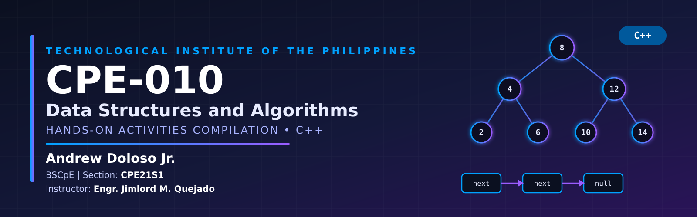

  <div align="center">

   # CPE-010: Data Structures and Algorithms
   ### Hands-on Activities Compilation

   

   
   
   

   </div>

   ---

   ## About This Portfolio

   - This repository is a compilation of all my **hands-on activities, exercises, and projects** for **CPE-010 – Data Structures and Algorithms**. It documents my progress across the semester, from basic concepts in the Prelim period up to the more advanced topics in the Finals, all implemented in **C++**.

   The goal of this portfolio is to:

   - Keep an organized record of my Hands-on Activities
   - Showcase my C++ problem-solving and programming skills
   - Serve as a reference for future review and projects

   ---
   ## INSTRUCTOR
   -  Engr. Jimlord M. Quejado
   ___
   
   ## About This Course
   - 

   ___

   ## About Me

   | | |
   |---|---|
   | **Name** | Andrew Doloso Jr. |
   | **Program** | Bachelor of Science in Computer Engineering (BSCpE) |
   | **School** | Technological Institute of the Philippines (T.I.P.) |
   | **Course** | CPE-010 – Data Structures and Algorithms |
   | **GitHub** | [@Dolosojrcpe](https://github.com/Dolosojrcpe) |
   | **Email** | qadolosojr@tip.edu.ph |
   |           |  andrewdolosojr@gmail.com |

   ---

   ## Repository Structure

   ```
   Portfolio_in_CPE-010/
   │
   ├── README.md        # You are here
   ├── PRELIM/          # Prelim period activities
   ├── MIDTERM/         # Midterm period activities
   ├── FINALS/          # Finals period activities
  
   ```
   ---

   ## Files Directory

   ### [PRELIM](./PRELIM)
   Foundations and introductory data structures.

   | Activity | Topic | Description |
   |---|---|---|
   | Hands-on Activity 1.1 | Basic C++ Programming | Short description |
   | Hands-on Activity 2.1 | Arrays, Pointers and Dynamic Memory | Short description |
   | Hands-on Activity 3.1 | Linked Lists | Short description |
   | Hands-on Activity 4.1 | Stacks | Short description |
   | Hands-on Activity 5.1 | Queues | Short description |
   ### [MIDTERM](./MIDTERM)
   Linear data structures.

   | Activity | Topic | Description |
   |---|---|---|
   | Hands-on Activity 6.1 | Searching Techniques | Short description |
   | Hands-on Activity 7.1 | Sorting Algorithms Pt1 | Queue implementation and operations |
   | Hands-on Activity 8.1 | Sorting Algorithms Pt2 | Short description |
   | Hands-on Activity 9.1 | Tree ADT | Short description |
   ### [FINALS](./FINALS)
   Advanced data structures and algorithms.

   | Activity | Topic | Description |
   |---|---|---|
   | Hands-on Activity 10.1 | Graphs | Short description |
   | Hands-on Activity 11.1 | Basic Algorithm Analysis | Short description |


   | Hands-on Activity 12.1 | Algorithmic Strategies | Short description |
   | Hands-on Activity 13.1 | Parallel Algorithms and Multithreading | Short description |
   | Hands-on Activity 14.1 | Algorithm Complexity | Short description |
   | Final Project | Project name | Short description |
   ---

   ## Topics Covered

   - [x] Arrays and Strings
   - [x] Linked Lists
   - [x] Stacks
   - [x] Queues
   - [x] Searching Algorithms
   - [x] Sorting Algorithms
   - [x] Trees and Graphs
   ---

   ## Contact

   - GitHub: [@Dolosojrcpe](https://github.com/Dolosojrcpe)
   - Email: qadolosojr@tip.edu.ph

   ---

   <div align="center"> * Thank you! * </div>

